# AI-BASED-SMART-HOME-SERVICES

An intelligent home-service platform where customers can find and book **verified home-service experts** (electricians, plumbers, AC technicians, cleaners, and more).

> **Current status: Phase 1 (foundation) + Phase 2 (discovery) + Phase 3
> (booking) + Phase 4 (real-time chat) + Phase 5 (live location tracking) +
> Phase 6 (Razorpay payments + reviews/ratings) + Phase 7 (Gemini AI
> assistant) + Phase 8 (RAG + ChromaDB) + Phase 9 (Real-time Notifications) +
> Phase 10 (Production Containerization & Turnkey Deployment) + React frontend — complete.**

## 📸 Platform Walkthrough & Screenshots

A comprehensive, line-wise visual tour of the platform across customer, expert, and administrator workflows:

---

### 1. Authentication & Secure Portal Access
Modern split-screen authentication with role-based routing (`CUSTOMER`, `EXPERT`, `ADMIN`), form validations, and JWT session handling.

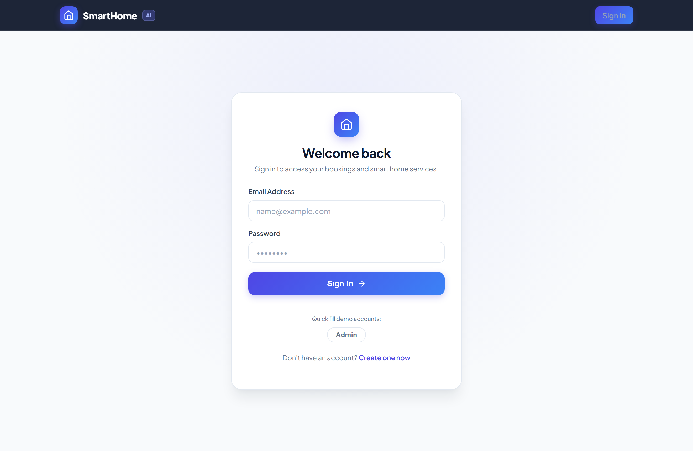

---

### 2. User & Expert Registration
Onboarding flow for new homeowners and service professionals with role selection and instant profile setup.

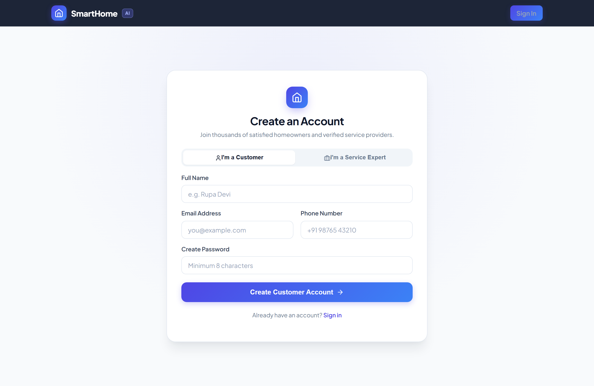

---

### 3. Customer Dashboard & KPI Overview
Personalized homeowner dashboard highlighting active bookings, quick service shortcuts, verified expert status, and live alert counters.

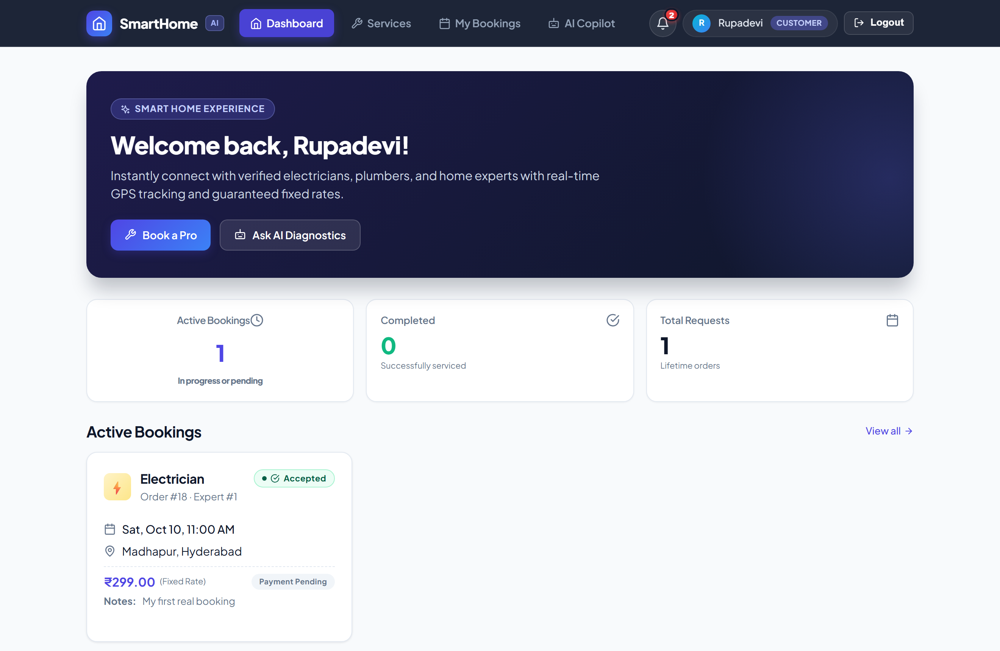

---

### 4. Service Catalogue & Categorized Pricing
Browse verified home services (Electrical, Plumbing, AC Repair, Smart Home Setup, Cleaning, Carpentry) with transparent pricing, estimated durations, and instant booking shortcuts.

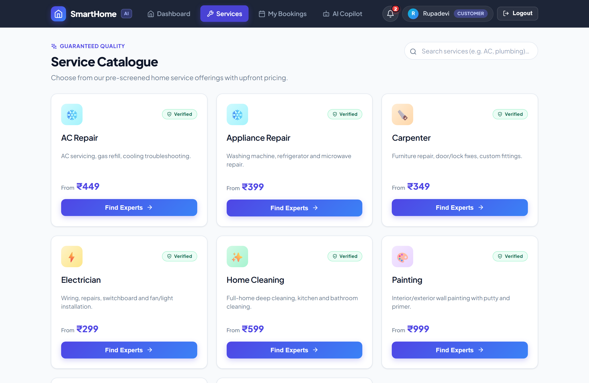

---

### 5. Nearby Verified Expert Discovery
Haversine-powered geolocation search displaying nearby rated technicians with distance calculation, verified badges, rating summaries, and available slots.

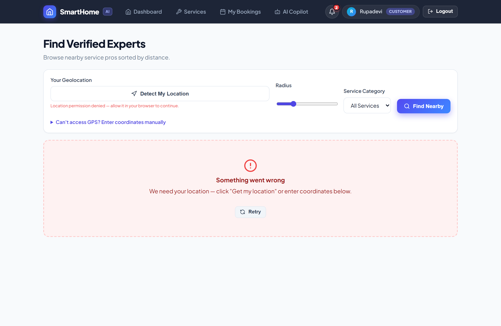

---

### 6. Appointment Booking & Schedule Confirmation
Comprehensive booking modal with selected technician profile, date/time slot picker, service address, and optional GPS geolocation tagging.

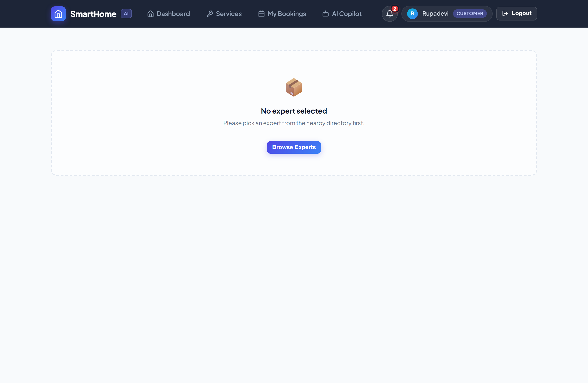

---

### 7. Customer Booking Management
Manage active and historical bookings with real-time status badges (`PENDING`, `ACCEPTED`, `COMPLETED`), cancellation actions, payment checkout, and service reviews.

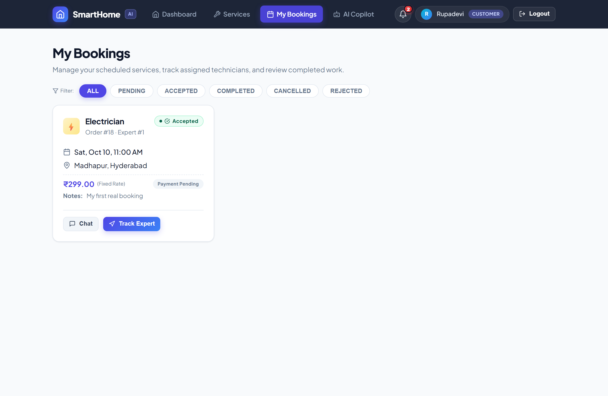

---

### 8. Smart Home AI Copilot & Diagnostics
Google Gemini-powered intelligent home service assistant with Retrieval-Augmented Generation (RAG) grounded in local knowledge bases for troubleshooting appliances, electrical issues, and plumbing leaks.

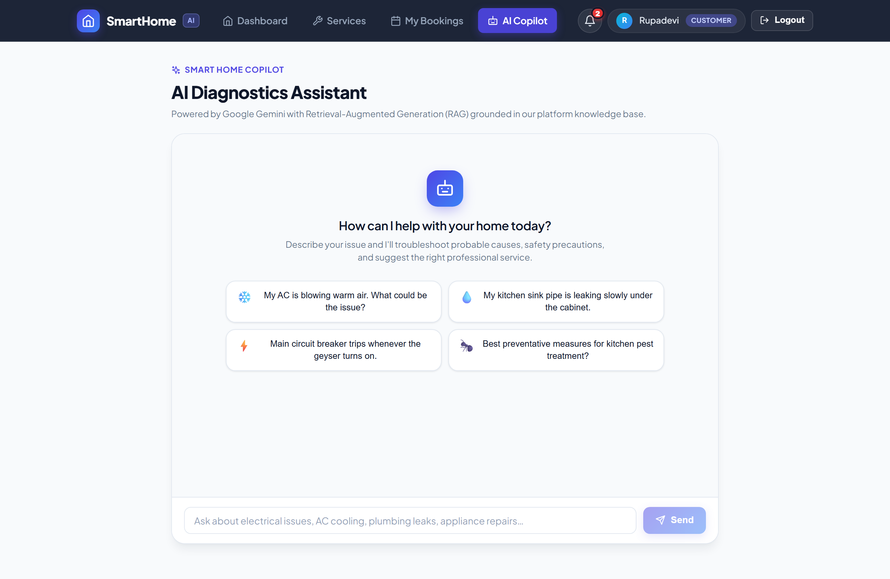

---

### 9. Real-Time In-App WebSocket Chat
Low-latency bidirectional WebSocket messaging between the customer and assigned expert for the active booking, featuring live delivery status and persistent message logs.

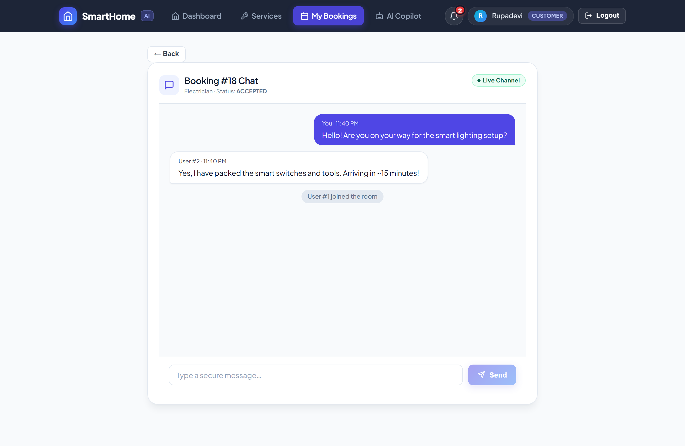

---

### 10. Live Expert GPS Tracking on OpenStreetMap
Live map visualization displaying real-time technician movement, route updates, distance metrics, and destination pin via high-frequency WebSocket streams.

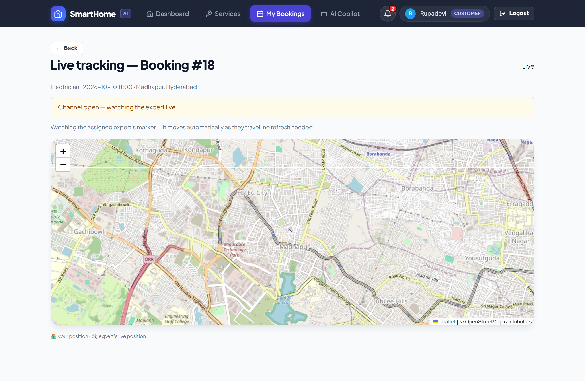

---

### 11. Real-Time Notifications Center
In-app notification system alerting users of booking status updates, technician arrivals, payments, and system notices with unread badges and direct navigation links.

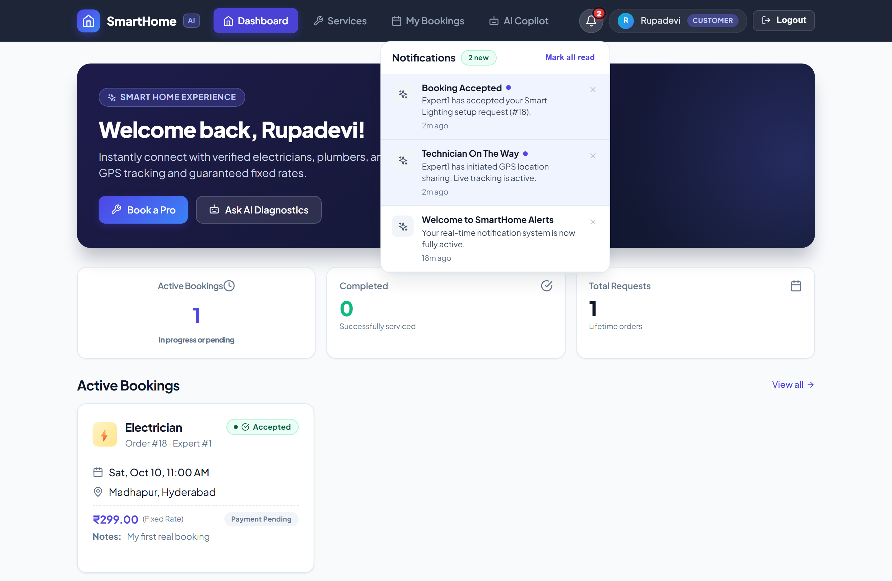

---

### 12. Service Expert Dashboard
Technician workspace featuring assigned jobs, incoming booking requests, one-click accept/reject controls, live status management, and performance stats.

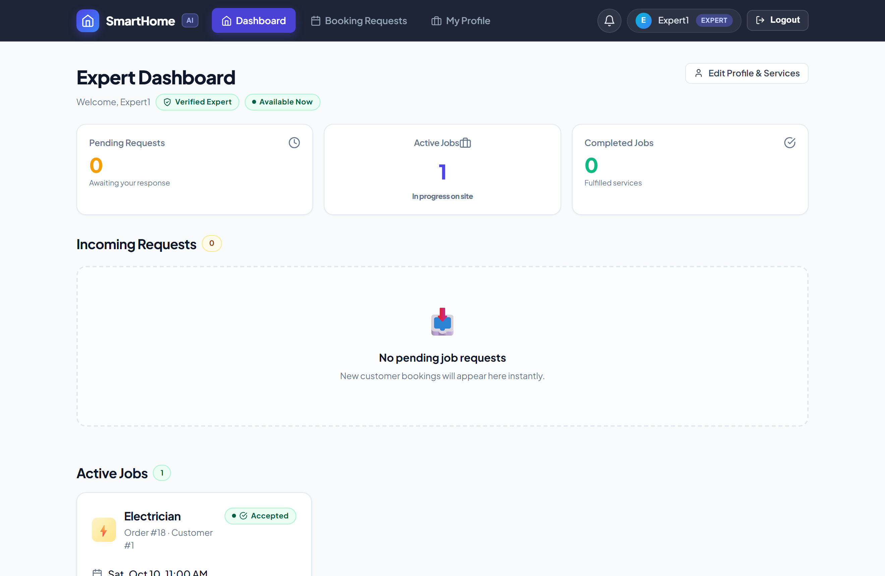

---

### 13. Expert Profile & Availability Management
Profile management interface for technicians to update skill sets, years of experience, operational radius, coordinates, and real-time availability toggle.

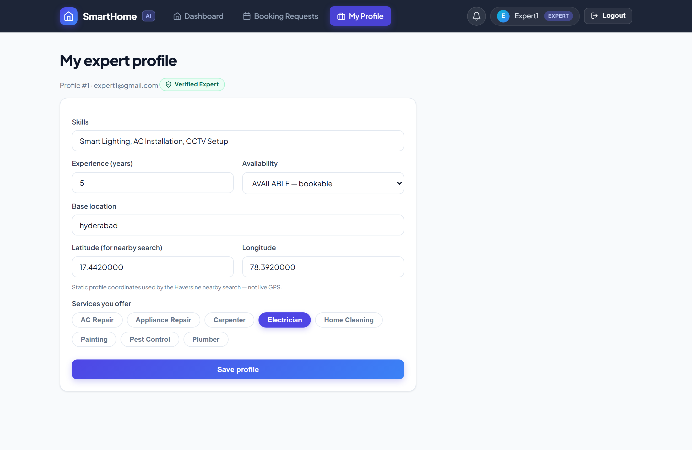

---

### 14. Administrator Control Center & System Oversight
Central admin dashboard featuring platform-wide KPI counters, expert credential verification approvals (`VERIFIED`, `REJECTED`), and user management.

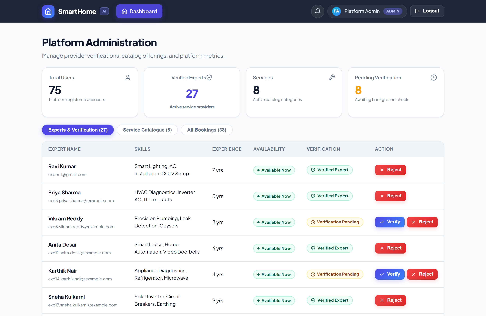

---

## What's implemented

**Phase 1** — FastAPI backend, MySQL via SQLAlchemy, User / ExpertProfile /
Service models, customer & expert registration, login, JWT authentication,
bcrypt password hashing, roles (`CUSTOMER`, `EXPERT`, `ADMIN`), role-protected
endpoints, Swagger docs, automated tests.

**Phase 2** — service catalogue APIs, admin service management, expert profile
management, expert↔service many-to-many relationships, admin verification
workflow (`PENDING / VERIFIED / REJECTED`), validated availability
(`AVAILABLE / UNAVAILABLE`), and **nearby expert search** using the Haversine
formula over *static* profile coordinates (experts manually enter
latitude/longitude — **no live GPS / location tracking**).

**Phase 3** — booking system: customers book verified experts
(`POST /bookings`) for a service at a date/time/address; experts manage
requests (`GET /experts/bookings`, accept / reject / complete); customers view
history (`GET /bookings/my`) and cancel; admins inspect all bookings. Full
lifecycle `PENDING → ACCEPTED → COMPLETED` (+ REJECTED/CANCELLED) with
server-validated transitions, service name/price **snapshots**, slot-conflict
detection (409), and `customer_id` always taken from the JWT.

Phase 3 does **NOT** include payments, chat, WebSockets, live tracking, AI/RAG,
reviews, or ratings.

**Phase 4** — real-time text communication: booking-scoped WebSocket chat
(`ws://host/ws/bookings/{booking_id}?token=<JWT>`) between the booking's
customer and its assigned expert, with JWT query-param authentication, a
booking-scoped connection manager, JSON message protocol (message / ping /
pong / join-leave events), persistence to a `messages` table, and a REST
history endpoint `GET /bookings/{booking_id}/messages`.

Phase 4 implements **text chat only** — no live location/GPS, video/audio
calls, payments, AI, or notifications.

**Phase 5** — live expert location tracking for **ACCEPTED** bookings only:
a dedicated WebSocket (`ws://host/ws/bookings/{booking_id}/location?token=<JWT>`) where the assigned expert sends `location_update` frames and the
booking's customer receives them in real time; `live_locations` table
(booking/user FKs, indexed); latest + history REST endpoints
(`GET /bookings/{booking_id}/location[/history]`, max 500 points); server-side
coordinate validation; throttling (`LOCATION_UPDATE_INTERVAL_SECONDS=1`);
booking-scoped privacy (never public, never cross-booking, admins excluded);
configurable retention (`LOCATION_HISTORY_RETENTION_DAYS=7`, explicit
opt-in cleanup — nothing deletes automatically). Browser demo page at
**`http://127.0.0.1:8000/location-demo`**.

**Phase 6** — **Razorpay payments + reviews/ratings** for COMPLETED bookings:
`POST /payments/create-order/{booking_id}` creates a Razorpay order (amount
always from the booking's price snapshot, never the client), the React app
opens Razorpay Checkout, and `POST /payments/verify` validates the
HMAC-SHA256 signature server-side (`order_id|payment_id` keyed with
`RAZORPAY_KEY_SECRET`) before flipping `payments.status = SUCCESS` and
`bookings.payment_status = PAID` — the frontend claim alone is never trusted.
A full review system (1-5 stars + comment, one per booking, edit/delete by
its author) recalculates each expert's `rating_avg` / `rating_count` on every
change; `GET /reviews/expert/{id}` is public for profile pages.

**Phase 7** — **Gemini LLM assistant**: `POST /llm/chat` (JWT; CUSTOMER and
EXPERT) sends the customer's question — plus an optional short client-side
history and context — to **Google Gemini** (`gemini-2.0-flash` REST via
httpx) under a controlled "Smart Home Service Assistant" system prompt. The
backend returns a single clean `response` string (never the raw provider
payload) and maps every failure to a controlled error code (503
`LLM_NOT_CONFIGURED` without a key, 502 rejected-key/upstream/empty, 429 rate
limit, 504 timeout). The key lives only in `backend/.env`; the assistant can
only *suggest* service categories — it has no tool access and can never
create bookings/payments or invent prices/availability. The React app adds
an **AI Assistant** page (chat bubbles, Thinking… state, friendly errors).
No database changes — conversation stays in React state.

**Phase 8** — **RAG (Retrieval-Augmented Generation)** grounds the Phase 7
assistant in a platform knowledge base (`knowledge_base/*.md`: plumbing,
electrical, AC repair, cleaning, appliance repair, home maintenance, safety,
FAQ). Documents are markdown-section chunked (size 800 / overlap 100),
embedded **locally** (all-MiniLM-L6-v2 ONNX via ChromaDB — no API key), and
stored in a persistent ChromaDB collection (index explicitly via
`python scripts/index_knowledge.py` — never at startup). `POST /llm/chat`
now embeds the question, retrieves the top-3 chunks above a calibrated
cosine-distance threshold (0.85), and builds a grounded Gemini prompt;
unrelated questions retrieve nothing and fall back to general knowledge with
`"grounded": false`. The endpoint contract is otherwise unchanged; retrieval
failures degrade gracefully to non-grounded chat.

**Frontend (React + Vite)** — a `frontend/` SPA connected to this backend:
JWT auth with role-guarded routes (CUSTOMER/EXPERT/ADMIN), service catalogue,
Haversine nearby-expert search (browser GPS or manual coordinates), booking
creation with status lifecycle, booking-scoped **WebSocket chat**, and
**live expert tracking** on a Leaflet/OpenStreetMap map — the assigned expert
streams `navigator.geolocation` positions over the Phase 5 WebSocket and the
customer's marker moves in real time. See `frontend/.env.example` and the
backend README for run instructions.

**Phase 9** — **Real-Time Notifications System**: end-to-end notification
service (`/notifications`, unread counters, mark as read, read-all, delete),
real-time event triggers fired on booking acceptance, payment verification,
review submissions, and admin approvals, with an interactive notification bell
and floating dropdown alert center in the React navigation header.

**Phase 10** — **Production Containerization & Turnkey Cloud Deployment**:
production multi-stage Dockerfiles for backend and frontend, optimized Nginx reverse
proxy configuration for REST & WebSocket upgrade streams (`/ws/`), container health
check probes (`/health`, `/healthz`), zero-downtime database wait & auto-initialization
script (`entrypoint.sh`), multi-service orchestration (`docker-compose.yml` and
`docker-compose.prod.yml`), one-click PaaS blueprint (`render.yaml`, `Procfile`),
production environment templates (`.env.production.example`), and complete
deployment guide in **[DEPLOYMENT.md](DEPLOYMENT.md)**.

## Quick start (Docker Compose - Production Ready)

To deploy the entire production stack (MySQL + Backend + Frontend + ChromaDB):

```bash
# 1. Copy the production environment configuration
cp .env.production.example .env.production

# 2. Launch the entire containerized stack
docker compose -f docker-compose.prod.yml --env-file .env.production up -d --build

# 3. Verify container health
docker compose -f docker-compose.prod.yml ps
```

Full deployment instructions: **[DEPLOYMENT.md](DEPLOYMENT.md)**.

## Quick start (Local Development)

```bash
cd backend
python -m venv .venv
.venv\Scripts\activate          # Windows  (Linux/macOS: source .venv/bin/activate)
pip install -r requirements.txt
copy .env.example .env          # then edit DATABASE_URL with your MySQL password
python -m app.init_db           # create/update tables + seed the 8 services
uvicorn app.main:app --reload   # http://127.0.0.1:8000/docs
```

## Testing

```bash
cd backend
.venv\Scripts\python -m pytest -v                 # 286 automated tests (no MySQL needed)
.venv\Scripts\python scripts\index_knowledge.py   # (re)index RAG knowledge base into ChromaDB
.venv\Scripts\python scripts\index_knowledge.py --demo  # show retrieval examples
.venv\Scripts\python scripts\live_acceptance.py   # 77 live checks vs running server
.venv\Scripts\python scripts\setup_chat_booking.py        # chat fixtures + booking id
.venv\Scripts\python scripts\websocket_test.py [id]       # two-client chat flow
.venv\Scripts\python scripts\ws_security_test.py [id]     # intruders denied
.venv\Scripts\python scripts\location_test.py             # two-client live-location flow
```

## Quick start (full stack dev)

```bash
# Terminal 1 — backend
cd backend
.venv\Scripts\activate
uvicorn app.main:app --reload          # http://127.0.0.1:8000/docs

# Terminal 2 — frontend
cd frontend
npm install                            # first time only
npm run dev                            # http://localhost:5173
```

## Structure

```
AI-BASED-SMART-HOME-SERVICES/
├── backend/                  # FastAPI application & REST/WebSocket APIs
│   ├── app/                  # Models, schemas, services, API routers
│   ├── Dockerfile            # Production Python container configuration
│   ├── entrypoint.sh         # Container boot, DB migration, & seeder
│   └── Procfile              # PaaS execution entrypoint
├── frontend/                 # React + Vite Single-Page Application
│   ├── src/                  # Components, pages, hooks, services
│   ├── Dockerfile            # Multi-stage build & production Nginx server
│   └── nginx.conf            # High-performance Nginx reverse proxy
├── knowledge_base/           # Markdown service guides for RAG embeddings
├── screenshots/              # 14 platform walkthrough screenshots
├── docker-compose.yml        # Development container stack
├── docker-compose.prod.yml   # Production VPS container stack
├── render.yaml               # Render.com Blueprint Infrastructure-as-Code
├── DEPLOYMENT.md             # Complete deployment & operations guide
├── .env.production.example   # Production environment template
├── .gitignore
└── README.md
```

Full documentation: **[backend/README.md](backend/README.md)** | **[DEPLOYMENT.md](DEPLOYMENT.md)**
